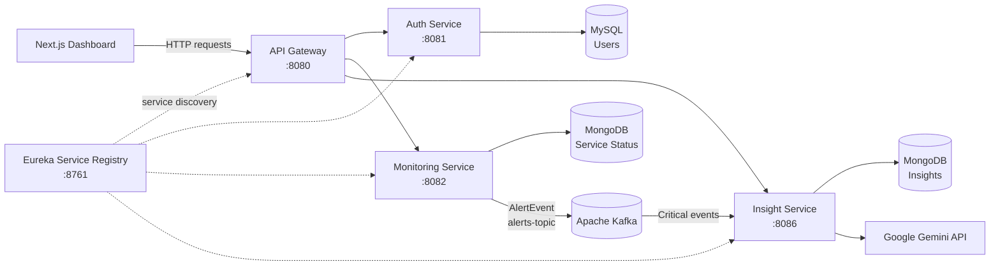

# SmartOps AI

SmartOps AI is an AI-assisted service monitoring platform built with **Java, Spring Boot microservices, Kafka, MongoDB, MySQL, Next.js, and Google Gemini**.

Users can register, sign in, add services to monitor, and view their service health from a dashboard. When a monitored service goes down, the Monitoring Service publishes an event through Kafka. The Insight Service processes qualifying critical events, asks Gemini to analyse the incident, and stores the generated insight for the dashboard.

## Features

- User registration and login with JWT-based authentication.
- Add, view, update, and remove monitored services.
- Periodically check monitored services through their Spring Boot Actuator health endpoint.
- View service status and dashboard counts for total, UP, and DOWN services.
- Publish an event when a service changes to DOWN instead of publishing a new alert on every monitoring cycle.
- Generate AI-based incident analysis with Google Gemini.
- View and delete saved insights.
- Keep monitored services and insights associated with the authenticated user.

## Architecture



### Main event flow

1. A user signs in and adds a service through the dashboard.
2. The API Gateway validates the user's JWT and forwards the request to the relevant backend service.
3. The Monitoring Service stores the monitored service with its owner information.
4. The monitoring process periodically calls the service's `/actuator/health` endpoint and updates its status.
5. When a service transitions to `DOWN`, the Monitoring Service publishes an `AlertEvent` to Kafka on `alerts-topic`.
6. The Insight Service consumes qualifying `CRITICAL` events and sends the incident details to Google Gemini.
7. The Insight Service saves the generated analysis in MongoDB.
8. The dashboard retrieves the user's monitored services and saved insights through the API.

## Services

| Service | Default port | Responsibility |
|---|---:|---|
| `service-registry` | `8761` | Eureka service discovery. |
| `api-gateway` | `8080` | Single API entry point, request routing, and JWT validation. |
| `auth-service` | `8081` | User registration, login, JWT creation, and user data. |
| `monitoring-service` | `8082` | Monitored service management, health checks, status updates, dashboard metrics, and Kafka event production. |
| `insight-service` | `8086` | Kafka event consumption, Gemini analysis, and insight persistence and retrieval. |
| `smartops-dashboard` | `3000` | Next.js user interface. |

The former standalone `alert-service` has been removed. Alert events are now produced by the Monitoring Service and consumed by the Insight Service. The current dashboard focuses on authentication, service management, service health, and AI insights; the previous logs, alerts, analytics, and WebSocket screens are not part of this simplified version.

## Technology stack

| Area | Technology |
|---|---|
| Backend | Java 21, Spring Boot, Spring Cloud |
| API gateway | Spring Cloud Gateway |
| Service discovery | Netflix Eureka |
| Authentication | Spring Security, JWT |
| Event messaging | Apache Kafka |
| User database | MySQL, Spring Data JPA / Hibernate |
| Operational data | MongoDB, Spring Data MongoDB |
| AI analysis | Google Gemini API |
| Frontend | Next.js, React, TypeScript |
| Build tools | Maven and npm |

## Data ownership

- The Auth Service stores user account data in MySQL.
- The Monitoring Service stores monitored service records in MongoDB, including the owning `userId`.
- The Monitoring Service includes the user identity in the Kafka event so the Insight Service can associate the resulting insight with the correct user.
- Insight queries and deletion operations are scoped by `userId`.

These checks are important for keeping one user's monitored services and insights separate from another user's data. Continue to enforce ownership checks in every resource-level endpoint when extending the application.

## Main API endpoints

All frontend API requests are intended to go through the API Gateway at `http://localhost:8080` during local development.

### Authentication

| Method | Endpoint | Purpose |
|---|---|---|
| `POST` | `/api/auth/register` | Register a user. |
| `POST` | `/api/auth/login` | Sign in and receive the authentication cookie. |
| `POST` | `/api/auth/logout` | Sign out. |
| `GET` | `/api/auth/me` | Get the current authenticated user. |

### Monitoring

| Method | Endpoint | Purpose |
|---|---|---|
| `POST` | `/api/monitor/services` | Add a service to monitor. |
| `GET` | `/api/monitor/services` | List the authenticated user's monitored services. |
| `GET` | `/api/monitor/services/{id}` | Get a monitored service. |
| `PUT` | `/api/monitor/services/{id}` | Update a monitored service. |
| `DELETE` | `/api/monitor/services/{id}` | Remove a monitored service. |
| `GET` | `/api/monitor/dashboard` | Get dashboard service counts. |

### Insights

| Method | Endpoint | Purpose |
|---|---|---|
| `GET` | `/api/insights` | List the authenticated user's insights. |
| `GET` | `/api/insights/{id}` | Get one insight belonging to the user. |
| `DELETE` | `/api/insights/{id}` | Delete one insight belonging to the user. |
| `DELETE` | `/api/insights` | Delete all insights belonging to the user. |
| `GET` | `/api/insights/count` | Get the user's insight count. |

> The endpoint list covers the main application flows. Check the controllers for the exact request and response DTOs before integrating additional clients.

## Local setup

### Prerequisites

- JDK 21
- Maven (or the Maven Wrapper included with a service)
- Node.js and npm
- MySQL
- MongoDB
- Docker Desktop or Docker Engine for Kafka
- A Google Gemini API key for AI insight generation

### 1. Clone the repository

```bash
git clone https://github.com/ivivekkushwaha/smartops-ai.git
cd smartops-ai
```

### 2. Start Kafka

Start the Kafka broker using the repository's Docker Compose configuration:

```bash
docker compose up -d
```

Make sure the broker address matches the `spring.kafka.bootstrap-servers` configuration used by the backend services. The topic used for incident events is `alerts-topic`.

### 3. Start the databases

Start MySQL and MongoDB and configure the connection details for the services. The Auth Service uses MySQL; the Monitoring and Insight Services use MongoDB.

### 4. Configure environment variables

Set the required values in your local environment or service-specific configuration. Do not commit real credentials to GitHub.

Common configuration includes:

| Variable / property | Used for |
|---|---|
| `GEMINI_API_KEY` | Google Gemini API authentication. |
| `KAFKA_BOOTSTRAP_SERVERS` | Kafka broker address where supported by the service configuration. |
| `INSIGHT_MONGODB_URI` | Insight Service MongoDB connection URI. |
| `EUREKA_DEFAULT_ZONE` | Eureka server URL where supported by the service configuration. |
| `NEXT_PUBLIC_API_URL` | Frontend API base URL; use `http://localhost:8080` for local development. |
| `jwt.secret` | JWT signing secret. Configure a strong private value in the Auth Service and the matching gateway validation configuration. |
| Database connection settings | MySQL and Monitoring Service MongoDB connection details. |

The exact environment-variable names can differ by service. Refer to each service's `application.properties` or `application.yml` before starting it.

### 5. Run the backend services

Start the services in separate terminals. Start Eureka first, then the backend services, and then the gateway.

From each service directory, use the Maven Wrapper if available:

```bash
./mvnw spring-boot:run
```

Or use installed Maven:

```bash
mvn spring-boot:run
```

Start these applications:

1. `service-registry`
2. `auth-service`
3. `monitoring-service`
4. `insight-service`
5. `api-gateway`

### 6. Run the frontend

```bash
cd smartops-dashboard
npm install
npm run dev
```

Open [http://localhost:3000](http://localhost:3000). Make sure `NEXT_PUBLIC_API_URL` points to the API Gateway.

## Testing and build

Run backend tests from the relevant service directory or from the root Maven build if the module is included there:

```bash
mvn test
```

Run the frontend checks from `smartops-dashboard`:

```bash
npm run lint
npm run build
```

The monitoring service includes tenant-isolation tests. Run the tests before merging further changes, and add integration tests for Kafka event handling, gateway authentication, database access, and the Gemini response flow as the project grows.

## Security notes

- Never commit `.env` files, API keys, database passwords, or JWT signing secrets.
- Keep JWT validation enabled at the gateway and enforce user ownership checks in backend service methods.
- Use HTTPS and secure cookie settings outside local development.
- Restrict CORS to trusted frontend origins before deployment.
- Keep database and Kafka credentials private and use least-privilege accounts.
- Treat the current project as a development/demo application until deployment security, resilience, monitoring, and integration testing have been fully reviewed.

## Current scope and next improvements

The current simplified version concentrates on the core workflow:

**Authenticate → Add monitored services → Check service health → Publish DOWN event → Generate Gemini insight → View insight.**

Potential next improvements include:

- Add stronger integration and end-to-end tests for the complete monitoring-to-insight flow.
- Add Kafka retry handling, dead-letter topics, and idempotent event processing.
- Add health checks, timeouts, and readiness handling for external service checks.
- Improve deployment configuration so local URLs and credentials are not hardcoded.
- Add structured application logging and production monitoring without reintroducing unused dashboard modules.

---

**SmartOps AI** — AI-assisted service monitoring and incident analysis built with Spring Boot microservices and Next.js.
